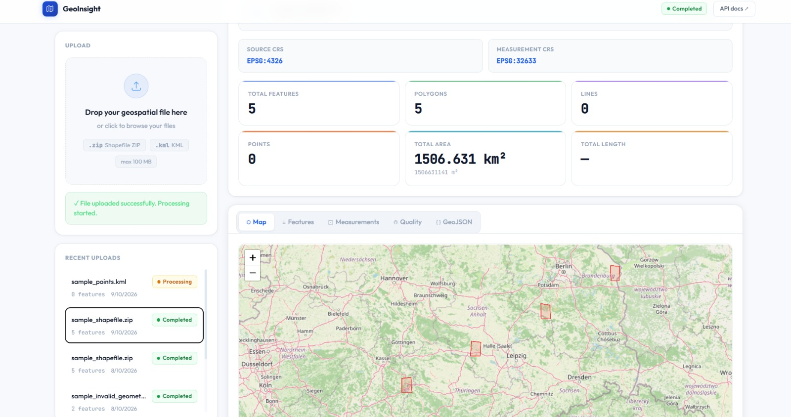
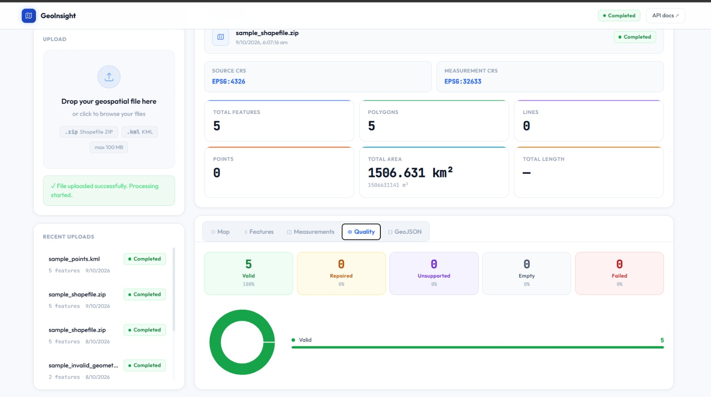

# 🌍 GeoInsight API

### Full-Stack Geospatial File Processing & Analytics Platform

GeoInsight API is a full-stack geospatial data processing application built with **FastAPI, React, TypeScript, GeoPandas, and Shapely**.

It enables users to upload Shapefiles or KML files, automatically process geospatial features, calculate geometry measurements, validate spatial data, and visualize results through an interactive dashboard.

The platform combines geospatial processing, RESTful API development, spatial analytics, and modern frontend visualization in a unified application.

---

## ✨ Key Features

- **Geospatial File Upload:** Supports `.zip` Shapefiles and `.kml` files.
- **Automated File Processing:** Processes uploaded files through asynchronous background tasks.
- **Geometry Measurements:** Calculates area, perimeter, and length of geospatial features.
- **Coordinate Reference System Handling:** Automatically selects an appropriate UTM projection for measurements.
- **Interactive Map Visualization:** Displays geospatial features using React-Leaflet and OpenStreetMap.
- **Geometry Validation & Repair:** Detects and attempts to repair invalid geometries using Shapely.
- **Quality Analysis:** Classifies features as VALID, REPAIRED, EMPTY, UNSUPPORTED, or FAILED.
- **Feature Inspection:** Provides searchable or filterable feature information through dashboard tables.
- **GeoJSON Export:** Converts processed geospatial features into downloadable GeoJSON.
- **Processing Status Monitoring:** Automatically updates the dashboard while files are being processed.
- **Secure Upload Validation:** Includes ZIP Slip prevention, file type checks, and ZIP size limits.
- **Docker Support:** Containerized deployment using Docker Compose.

---

## 🛠️ Technology Stack

| Layer | Technologies |
|---|---|
| Backend | Python, FastAPI |
| Frontend | React, TypeScript, Vite |
| Styling | Tailwind CSS v4 |
| Geospatial Processing | GeoPandas, Shapely, Fiona |
| Map Visualization | React-Leaflet, OpenStreetMap |
| Database | SQLite, SQLAlchemy |
| Data Validation | Pydantic |
| Data Fetching | Axios, TanStack Query |
| API Documentation | Swagger UI / OpenAPI |
| Testing | Pytest |
| Containerization | Docker, Docker Compose |
| Web Server | Nginx |

---

## 🚀 Quick Start

### Prerequisites

Ensure you have the following installed:

- Python 3.10 or later (with compatible dependencies)
- Node.js and npm
- Git
- Docker and Docker Compose (optional)

### 1. Clone the Repository

```bash
git clone https://github.com/pavithrab30/geo.git
cd geo
```

### 2. Backend Setup

Navigate to the backend directory:

```bash
cd backend
```

Create a Python virtual environment:

```bash
python -m venv .venv
```

Activate the virtual environment.

**Windows:**

```powershell
.venv\Scripts\activate
```

**macOS / Linux:**

```bash
source .venv/bin/activate
```

Install the required dependencies:

```bash
pip install -r requirements.txt
```

Start the FastAPI server:

```bash
uvicorn app.main:app --reload
```

Backend API:

http://localhost:8000

Interactive API documentation:

http://localhost:8000/docs

### 3. Frontend Setup

Open a new terminal and navigate to the frontend directory:

```bash
cd frontend
```

Install dependencies:

```bash
npm install
```

Start the development server:

```bash
npm run dev
```

Frontend dashboard:

http://localhost:5173

### 4. Docker Deployment (Optional)

Run the following command from the project root:

```bash
docker-compose up --build
```

Access the application:

| Service | URL |
|---|---|
| Frontend Dashboard | http://localhost:80 |
| Backend API | http://localhost:8000 |
| Swagger Documentation | http://localhost:8000/docs |

---

## 📸 Dashboard Output

The following screenshots demonstrate the GeoInsight dashboard and its geospatial processing capabilities.

### Dashboard Preview



### Geospatial Processing Results



---

## 📂 Project Structure

```text
geo/
├── backend/
│   ├── app/
│   │   ├── main.py
│   │   ├── config.py
│   │   ├── database.py
│   │   ├── models.py
│   │   ├── schemas.py
│   │   │
│   │   ├── routers/
│   │   │   ├── files.py
│   │   │   ├── features.py
│   │   │   ├── measurements.py
│   │   │   ├── summary.py
│   │   │   ├── geojson.py
│   │   │   └── health.py
│   │   │
│   │   └── services/
│   │       ├── file_validator.py
│   │       ├── crs_service.py
│   │       └── geometry_service.py
│   │
│   ├── tests/
│   ├── generate_sample_data.py
│   ├── requirements.txt
│   └── Dockerfile
│
├── frontend/
│   ├── src/
│   │   ├── components/
│   │   │   ├── FileUploader.tsx
│   │   │   ├── FileSummary.tsx
│   │   │   ├── StatusBadge.tsx
│   │   │   ├── GeoMap.tsx
│   │   │   ├── GeoJSONViewer.tsx
│   │   │   ├── FeatureTable.tsx
│   │   │   ├── MeasurementTable.tsx
│   │   │   ├── QualityReport.tsx
│   │   │   └── Skeleton.tsx
│   │   │
│   │   ├── hooks/
│   │   │   ├── useGeoFile.ts
│   │   │   └── useProcessingData.ts
│   │   │
│   │   ├── services/
│   │   │   └── api.ts
│   │   │
│   │   ├── types/
│   │   │   └── index.ts
│   │   │
│   │   ├── pages/
│   │   │   └── DashboardPage.tsx
│   │   │
│   │   ├── App.tsx
│   │   └── main.tsx
│   │
│   ├── Dockerfile
│   ├── nginx.conf
│   └── package.json
│
├── docker-compose.yml
├── img1.jpeg
├── img2.jpeg
└── README.md
```

---

## 🔗 API Reference

The application exposes RESTful endpoints for uploading, processing, and retrieving geospatial information.

| Method | Endpoint | Description |
|---|---|---|
| GET | `/health` | Check API health |
| POST | `/api/files/` | Upload a Shapefile ZIP or KML |
| GET | `/api/files/` | List uploaded files |
| GET | `/api/files/{id}` | Retrieve file metadata and processing status |
| GET | `/api/files/{id}/summary/` | Retrieve feature counts and measurement summaries |
| GET | `/api/files/{id}/features/` | Retrieve paginated geospatial features |
| GET | `/api/files/{id}/measurements/` | Retrieve feature measurements |
| GET | `/api/files/{id}/quality/` | Retrieve geometry quality statistics |
| GET | `/api/files/{id}/geojson/` | Export features as GeoJSON |

### Upload a Geospatial File

Example using cURL:

```bash
curl -X POST http://localhost:8000/api/files/ \
  -F "file=@sample_data/sample_shapefile.zip"
```

### Retrieve File Processing Status

```bash
curl http://localhost:8000/api/files/1
```

### Retrieve Feature Measurements

```bash
curl http://localhost:8000/api/files/1/measurements/
```

### Export GeoJSON

```bash
curl http://localhost:8000/api/files/1/geojson/
```

---

## ⚙️ Geospatial Processing Workflow

GeoInsight follows a structured processing pipeline to ensure accurate measurements and reliable results.

```text
                 FILE UPLOAD
                      |
                      v
              FILE VALIDATION
                      |
                      v
               SECURE STORAGE
                      |
                      v
             BACKGROUND PROCESS
                      |
                      v
         READ SHAPEFILE / KML FILE
                      |
                      v
             DETECT SOURCE CRS
                      |
                      v
            SELECT UTM PROJECTION
                      |
                      v
              EXTRACT FEATURES
                      |
                      v
             VALIDATE GEOMETRY
                      |
                +-----+-----+
                |           |
              VALID       INVALID
                |           |
                |      ATTEMPT REPAIR
                |           |
                +-----+-----+
                      |
                      v
            CALCULATE MEASUREMENTS
                      |
                      v
              STORE IN DATABASE
                      |
                      v
             GENERATE FILE SUMMARY
                      |
                      v
           VISUALIZE ON DASHBOARD
                      |
                      v
               EXPORT GEOJSON
```

### Processing Steps

1. **Upload:** User uploads a ZIP-based Shapefile or KML file.
2. **Validation:** The backend validates the uploaded file and checks security constraints.
3. **Parsing:** GeoPandas reads the geospatial dataset.
4. **CRS Detection:** The original Coordinate Reference System is identified.
5. **Projection:** Geometries are transformed to a suitable projected CRS for measurements.
6. **Geometry Validation:** Each feature is checked for invalid or unsupported geometry.
7. **Geometry Repair:** The system attempts to repair invalid geometries using Shapely.
8. **Measurement:** Areas, perimeters, and lengths are computed.
9. **Persistence:** Features and measurements are stored using SQLAlchemy.
10. **Visualization:** Results are displayed in the React dashboard.

---

## 🌐 Coordinate Reference System Strategy

Calculating area and distance directly using geographic coordinates such as EPSG:4326 can produce incorrect measurements because coordinates are expressed in degrees.

GeoInsight addresses this by projecting geometries into an appropriate UTM coordinate system.

### UTM Selection Strategy

1. Identify the source CRS.
2. Convert the dataset centroid to WGS84 coordinates.
3. Determine the UTM zone using longitude.
4. Select the appropriate Northern or Southern Hemisphere EPSG code.
5. Reproject geometries into the selected CRS.
6. Compute measurements in metric units.

UTM zone selection:

```python
zone = int((longitude + 180) / 6) % 60 + 1
```

EPSG selection:

```python
epsg = 32600 + zone if latitude >= 0 else 32700 + zone
```

### Supported Measurements

| Geometry Type | Measurements |
|---|---|
| Point | Geometry coordinates |
| LineString | Length |
| Polygon | Area and perimeter |
| MultiLineString | Total length |
| MultiPolygon | Total area and perimeter |

Measurements are returned in metric units such as metres and square metres, with additional unit conversions where supported.

**Note:** A single UTM projection is most appropriate for datasets concentrated within one geographic region. Very large or cross-zone datasets may require an alternative projection strategy.

---

## 🛡️ Security Features

GeoInsight includes defensive file-processing measures designed to reduce upload-related security risks.

| Security Control | Description |
|---|---|
| ZIP Slip Prevention | Rejects unsafe archive paths that could escape the extraction directory |
| File Type Validation | Verifies accepted geospatial file formats |
| Dangerous File Rejection | Blocks potentially unsafe executable and script files inside ZIP archives |
| ZIP Size Limits | Checks archive entries against configured size limits |
| UUID File Naming | Generates unique storage names for uploaded files |
| Geometry Validation | Identifies malformed and unsupported spatial features |
| Input Validation | Uses Pydantic models for request and response validation |

These controls provide a foundation for safer file handling. Additional resource limits, authentication, and infrastructure hardening would be appropriate before a public production deployment.

---

## 🧪 Testing

The backend includes a Pytest-based testing suite covering file validation, coordinate handling, geometry processing, and REST API behavior.

### Run Tests

```bash
cd backend
pytest tests/ -v
```

### Test Coverage Areas

- File upload validation
- ZIP Slip prevention
- Unsupported file formats
- Missing Shapefile components
- KML file parsing
- Coordinate Reference System selection
- Geometry validation and repair
- Empty and unsupported geometries
- API endpoint responses
- File processing status
- Health checks

The project includes **43 test cases** covering major backend components.

---

## 🏗️ Architecture & Design Decisions

GeoInsight follows a layered full-stack architecture.

| Component | Responsibility |
|---|---|
| React Frontend | User interaction, file uploads, dashboards, and visualizations |
| FastAPI Backend | REST endpoints, input validation, and processing orchestration |
| Service Layer | File validation, CRS selection, and geometry processing |
| GeoPandas | Geospatial file parsing and coordinate transformations |
| Shapely | Geometry operations, validation, and repair |
| SQLAlchemy | Database modeling and persistence |
| SQLite | Storage of processed file metadata, features, and measurements |
| TanStack Query | Client-side caching and processing-status polling |
| React-Leaflet | Map-based geospatial visualization |
| Docker Compose | Coordinated frontend and backend deployment |

### Important Design Choices

**FastAPI:** Provides automatic OpenAPI documentation, Python type support, and a clean foundation for REST services.

**SQLite + SQLAlchemy:** Keeps local development simple while allowing a future migration to PostgreSQL.

**Background Tasks:** Allows the API to accept uploaded files without keeping the upload request open throughout processing.

**GeoPandas + Shapely:** Provides mature geospatial parsing, validation, transformation, and measurement capabilities.

**TanStack Query:** Simplifies data fetching, caching, and periodic status updates.

**React-Leaflet:** Enables interactive visualization using OpenStreetMap tiles without requiring a proprietary mapping API key.

---

## 📊 Generating Sample Geospatial Data

The repository includes a sample data generator for local testing.

Run:

```bash
cd backend
python generate_sample_data.py
```

The script generates sample geospatial datasets, including:

| Sample File | Description |
|---|---|
| `sample_shapefile.zip` | Sample polygon geometries |
| `sample_points.kml` | Geographic point features |
| `sample_invalid_geometries.zip` | Invalid geometries for testing repair |

These sample datasets can be uploaded directly through the dashboard or API.

---

## 🔮 Future Enhancements

Potential improvements for future versions include:

- PostgreSQL and PostGIS integration for advanced spatial queries
- Celery and Redis for distributed background processing
- GeoTIFF raster file support
- JWT-based user authentication
- WebSocket-based live processing updates
- Large-file streaming and chunked uploads
- Automatic cleanup of expired uploads
- Advanced spatial filtering and search
- Additional export formats such as CSV and KML
- Cloud deployment and object storage
- CI/CD pipelines for automated testing and deployment

---

## 📌 Project Highlights

GeoInsight demonstrates practical engineering concepts across backend development, frontend development, spatial data processing, and software architecture.

The project brings together:

- Full-stack application development
- RESTful API design
- Secure file upload handling
- Spatial coordinate transformations
- Geometry validation and repair
- Database-driven data management
- Interactive geospatial visualization
- Automated backend testing
- Containerized deployment

---

